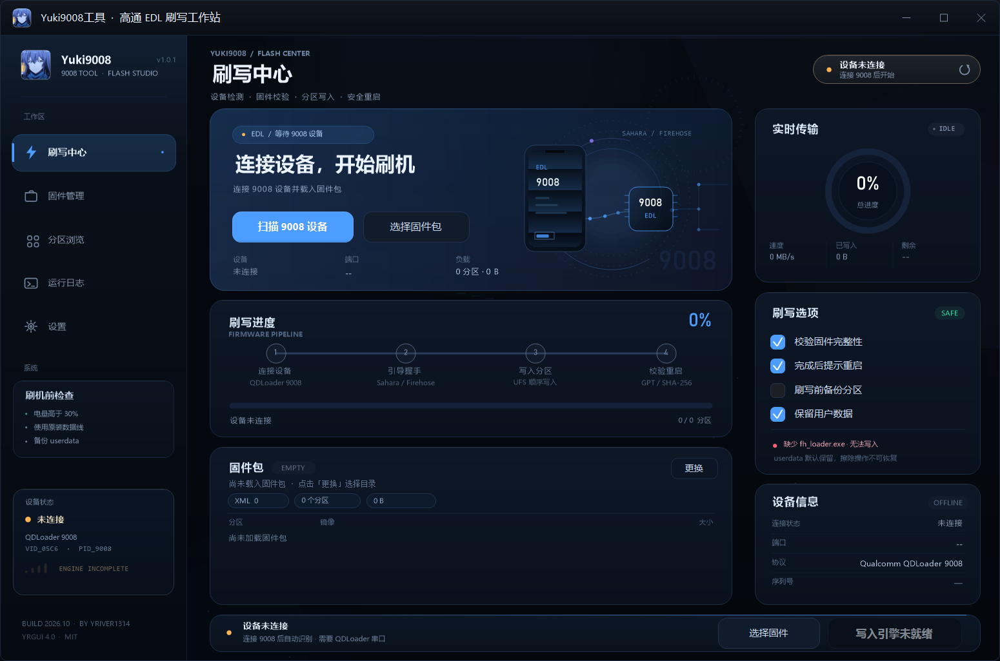

# Yuki9008工具

> 高通 9008 / QDLoader EDL 可视化刷机工具  
> Qualcomm Emergency Download Studio · Modern dark UI · Rich motion
>
> 作者：**yriver1314**  
> GitHub：<https://github.com/yriver1314/Yuki9008Tool>  
> 当前版本：**1.0.4**



## 工具定位

Yuki9008工具 把高通 9008（QDLoader / EDL）刷机流程做成一个完整的 Windows
桌面工作站：自动识别设备、解析固件包、浏览分区、调用真实 QFIL 命令行写入，
并实时展示进度、速度、剩余时间和完整日志。

## 核心功能

### 1. 设备检测与 EDL 状态

- 通过 SetupAPI 枚举 `VID_05C6 / PID_9008`，兼容 `900E`
- 自动读取设备名称、序列号和 `COMx` 端口
- 区分“已连接”“EDL 写入中”“刷写完成”“离线”四种状态
- `F5` 随时重新扫描，不需要重启工具
- 没有 COM 端口时拒绝启动写入，避免对错误设备操作

### 2. 固件包解析

- 选择或拖入解压后的固件目录
- 自动查找 `rawprogram*.xml` / `patch*.xml` / `prog_firehose*`
- 解析分区标签、镜像文件名、文件大小、Sparse 标记
- 计算整个固件包的 SHA-256 指纹
- 识别 Firehose 编程器、Mapping XML、分区数量和总负载
- 固件包为空、缺少 XML 或缺少编程器时给出明确提示

### 3. 真实 QFIL 写入后端

- `QSaharaServer.exe` 发送 Firehose 编程器
- `fh_loader.exe` 写入 `rawprogram` 分区
- 存在 `patch*.xml` 时自动追加 patch 阶段
- 解析写入工具标准输出中的百分比，更新进度、速度和已写入数据量
- 捕获 stdout / stderr 到运行日志
- 失败时显示退出码和错误日志，支持手动停止并终止子进程
- UFS / eMMC 根据编程器和固件路径自动推断
- 完整 QFIL 2.0.3.5 GUI 随包提供；设置页可直接“打开 QFIL”手动刷写

### 4. 分区浏览与日志

- 独立分区页：搜索、类型过滤、写入状态、镜像大小
- 支持导出 CSV，方便核对分区表
- 运行日志页实时滚动，保留完整 QFIL 会话
- 日志可清空、导出 UTF-8 文本
- 右侧“实时传输”面板显示总进度、速度、已写入和剩余时间

### 5. 界面与交互

- 无边框自绘窗口、Per-Monitor V2 DPI
- 三栏布局：侧栏 / 主工作区 / 实时状态栏 / 底部操作条
- EDL 环形轨道、扫描线、数据脉冲、进度光效、完成彩带
- 四种强调色、动效开关、堆叠 Toast
- 标题栏、侧栏、窗口图标和 exe 资源图标统一使用 `logo.ico`
- 拖拽固件目录到窗口即可载入

### 6. GitHub 更新通道

- 设置页直接检查 GitHub Releases
- 读取 latest release tag，与当前 `1.0.4` 比较
- 显示“已是最新”“发现新版本”“检查失败”
- 有新版时打开发行包下载地址
- 仓库：<https://github.com/yriver1314/Yuki9008Tool>

## 首次使用：安装驱动和运行库

发行包 `Driver\` 已包含完整安装程序：

```text
vcredist_x86.exe                           VC++ 2010 x86 运行库（QDmssLoader 必需）
vcredist_x64.exe                           VC++ 2010 x64 运行库
Qualcomm USB Driver v1.0.10065.1.exe       Qualcomm 9008 驱动
QDLoader HS-USB Driver_64bit_Setup.exe     QDLoader 9008 驱动（64 位）
QDLoader HS-USB Driver_32bit_Setup.exe     QDLoader 9008 驱动（32 位）
```

建议按以下顺序安装：

1. 运行 `vcredist_x86.exe` 和 `vcredist_x64.exe`
2. 运行 `Qualcomm USB Driver v1.0.10065.1.exe`
3. 如仍无法识别，再安装对应系统的 `QDLoader HS-USB Driver_*_Setup.exe`
4. 重启设备并重新进入 9008，确认设备管理器出现 `QDLoader 9008 (COMx)`

工具启动时会检查运行库和 9008 驱动；缺失时会弹出首次使用提示。
设置页也提供 **打开 Driver · 安装 9008 驱动与 VC++ 运行库** 按钮。

## 使用流程

1. 安装并连接高通 9008 驱动，让设备在设备管理器中显示为 `QDLoader 9008 (COMx)`
2. 打开工具，点击“扫描 9008 设备”
3. 选择或拖入固件目录（包含 `rawprogram*.xml` 和 `prog_firehose*`）
4. 在“固件管理”页确认编程器、分区数量和总大小
5. 确认右侧写入引擎为 `QFIL READY`
6. 点击“开始刷写”，保持 USB 连接直到显示完成
7. 完成后手动重启设备；重新进入 9008 后可再次刷写

如果当前只有 QFIL GUI、没有 `fh_loader.exe`，工具会显示 `QFIL GUI READY`。
此时进入设置页点击 **打开 QFIL**，用 QFIL 2.0.3.5 图形界面手动刷写。

## 发行包内容

GitHub Release 的 Windows 包包含：

```text
Yuki9008Tool.exe
logo.ico
libwinpthread-1.dll
README.md
preview.png
bin\                 # QFIL 2.0.3.5 + QSaharaServer + fh_loader
Driver\              # VC++ 2010 运行库 + Qualcomm 9008 驱动
```

`bin` 和 `Driver` 会随 `build.bat` 一起复制到 `dist\`，并打包进 Release。
源码仓库不提交这些第三方二进制，只在发行包中提供。

## bin / QFIL 实测结果

当前 `bin` 目录包含：

```text
QFIL.exe                 # QFIL 2.0.3.5 图形界面
QSaharaServer.exe
fh_loader.exe            # Firehose 写入 CLI
QDmssLoader.exe
QC.QMSLPhone.dll
QMSL_MSVC10R.dll
QualCtrl.dll
SwDownloadDLL.dll
Credits.txt / *.url
```

实测结果：

| 组件 | 结果 |
| --- | --- |
| `QFIL.exe` | **可用**：QFIL 2.0.3.5 GUI 能启动并进入加载流程 |
| `QSaharaServer.exe` | **可用**：能启动并打印完整帮助，退出码 0；支持 `-p \\.\COMn` 和 `-u <port>` |
| `fh_loader.exe` | **可用**：版本 `17.04.27.14.27`，`--port` / `--sendxml` / `--search_path` / `--memoryname` 等参数完整，帮助退出码 0 |
| `QDmssLoader.exe` | **安装 VC++ 2010 x86 后可用**：已能打印完整参数帮助 |
| `Driver\*Setup.exe` | **签名有效**：Qualcomm 官方签名，未在本机安装测试 |
| `Driver\vcredist_*.exe` | **签名有效**：Microsoft 官方 VC++ 2010 10.0.40219 运行库 |

结论：**QFIL 2.0.3.5 完整 GUI + `fh_loader.exe` 已加入 bin**，工具现在可以进入
`QFIL READY` 状态，使用 `QSaharaServer + fh_loader` 一键写入；设置页仍保留
“打开 QFIL”作为手动刷写入口。当前环境没有 9008 设备，硬件写入未做端到端测试。

> 首次使用请先安装 `Driver\vcredist_x86.exe`、`vcredist_x64.exe` 和 Qualcomm
> 9008 驱动；否则 QDmssLoader 会因缺少 VC++ 2010 运行库而无法启动。

## 写入引擎检测顺序

工具按以下顺序查找 `QSaharaServer.exe` 与 `fh_loader.exe`：

1. `YUKI9008_ENGINE_DIR` 环境变量
2. 当前 exe 目录
3. exe 目录下的 `bin\`
4. exe 目录下的 `QFIL\`
5. `C:\Program Files (x86)\Qualcomm\QPST\bin`
6. `C:\Program Files\Qualcomm\QPST\bin`
7. `C:\Program Files (x86)\Qualcomm\QFIL`
8. `C:\Program Files\Qualcomm\QFIL`
9. `PATH` 中的目录

只有 `QSaharaServer.exe` 与 `fh_loader.exe` 都找到，右侧才显示 `QFIL READY`。
如果找到 `QFIL.exe` 但缺少 `fh_loader.exe`，显示 `QFIL GUI READY`，可直接打开
QFIL GUI 手动刷写。

## 快速开始

解压发行包后运行：

```text
Yuki9008Tool.exe
```

`Yuki9008Tool.exe` 需要与 `logo.ico`、`libwinpthread-1.dll` 位于同一目录。
源码构建输出在 `dist\`。

## 构建

```bat
build.bat
```

手动命令：

```bat
windres --codepage=65001 version.rc -O coff -o version.res
g++ main.cpp app_state.cpp paint.cpp paint_foreground.cpp paint_cards.cpp paint_pages.cpp version.res ^
  -o Yuki9008Tool.exe -mwindows -std=c++17 -O2 ^
  -finput-charset=UTF-8 -fexec-charset=UTF-8 ^
  -lgdiplus -lgdi32 -luser32 -ldwmapi -luxtheme ^
  -lole32 -luuid -lshell32 -lsetupapi -lcomctl32 -lbcrypt -lwinhttp ^
  -static-libgcc -static-libstdc++
```

- MinGW-w64 GCC 15.2
- 不依赖 Qt / .NET，只使用 Windows 自带库
- `libwinpthread-1.dll` 随发行包提供

## 快捷键

| 快捷键 | 动作 |
| --- | --- |
| `Ctrl + Enter` | 开始 / 重新开始刷写（仅在设备、固件、引擎就绪时有效） |
| `F5` | 重新扫描 9008 设备 |
| `Ctrl + L` | 打开运行日志 |

## 真实写入命令

```text
QSaharaServer.exe -u <COM号> -s 13:"<prog_firehose...>"
fh_loader.exe --port=\\.\COMn --sendxml="rawprogram0.xml" --search_path="<固件目录>" --memoryname=ufs|emmc --noprompt --showpercentagecomplete --zlpawarehost=1
```

存在 `patch*.xml` 时追加：

```text
fh_loader.exe --port=\\.\COMn --sendxml="patch0.xml" ...
```

> UFS / eMMC 根据固件路径和编程器文件名推断；如固件有明确要求，请确认目录或
> 编程器名称包含 `ufs` / `emmc`。

## 目录

```text
.
├── YRGui.h                  # YRGui 4.0
├── main.cpp                 # 入口、窗口子类、拖拽与快捷键
├── app_state.h/.cpp         # 状态机、设备 / 固件 / QFIL / 更新
├── paint.cpp                # 基础绘制、图标、背景
├── paint_foreground.cpp     # 侧栏、标题区、Hero、阶段、仪表
├── paint_cards.cpp          # 固件、传输、选项、设备、操作栏
├── paint_pages.cpp          # 固件 / 分区 / 日志 / 设置页
├── logo.ico                 # 应用与界面 logo
├── version.rc               # 图标、作者与版本资源
├── LICENSE
├── .gitignore
├── build.bat
├── preview.png
├── bin/                     # QFIL 命令行组件（发行包）
├── Driver/                  # Qualcomm USB 驱动（发行包）
└── dist/
    ├── Yuki9008Tool.exe
    ├── logo.ico
    ├── libwinpthread-1.dll
    ├── README.md
    ├── preview.png
    ├── bin/
    └── Driver/
```

## 设计

- 深色「午夜蓝 + 电光青」视觉，强调色可切换
- 逻辑像素布局，随系统 DPI 缩放
- 颜色语义：`ink / dim / accent / green / amber / red`
- 30 FPS 动画循环，空闲自动降频
- 关闭动效后仍保留进度和状态反馈

## 许可

- YRGui 4.0：MIT
- Yuki9008工具 应用代码：MIT
- `bin/` 与 `Driver/` 中的 Qualcomm 组件归其各自权利人所有，仅随发行包分发

> 刷机有风险。请先确认机型、固件、分区表与供电状态，并确保 QFIL 组件与设备匹配。
